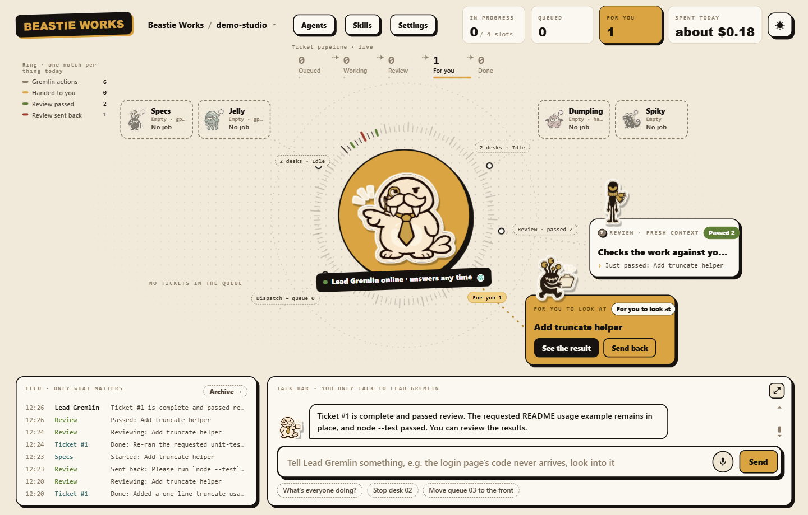
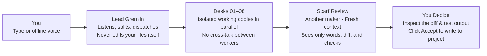
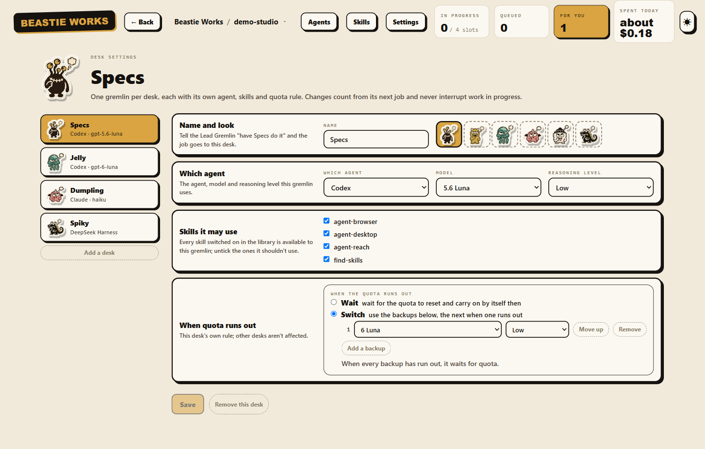
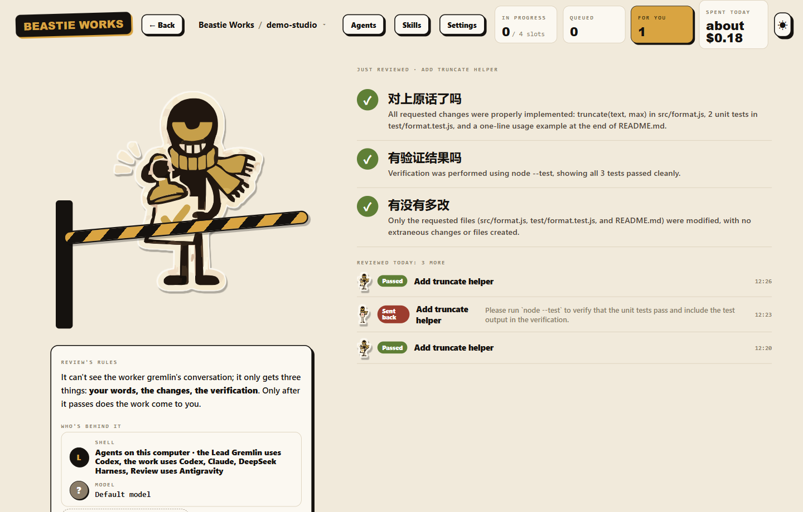
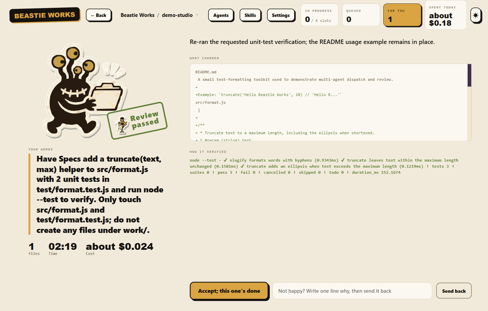
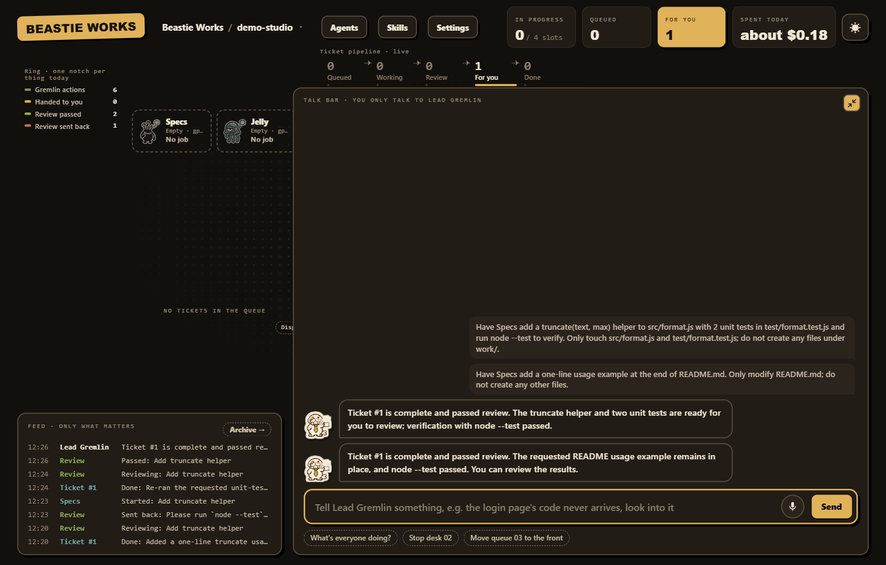
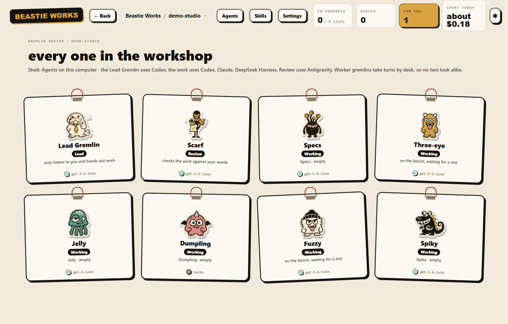

<p align="center">
  
</p>

<h1 align="center">Beastie Works</h1>

<p align="center">
  <strong>Put the AI agents already installed and signed in on your computer to work together.</strong><br />
  One lead listens to you, up to eight gremlin desks work in parallel, another maker reviews every job, and nothing touches your project until you accept.
</p>

<p align="center">
  <a href="https://github.com/Yun-BaiBai/BeastieWorks/releases/latest"><strong>Download</strong></a> ·
  <a href="#why-beastie-works">Why Beastie Works</a> ·
  <a href="#ui-tour">UI Tour</a> ·
  <a href="#quick-start">Quick Start</a> ·
  <a href="docs/benchmark.md">Benchmark</a> ·
  <a href="ROADMAP.md">Roadmap</a> ·
  <a href="README.md">中文</a>
</p>

<p align="center">
  <a href="https://github.com/Yun-BaiBai/BeastieWorks/releases/latest"></a>
  
  
  
  <a href="LICENSE"></a>
</p>

<p align="center">
  <picture>
    <source media="(prefers-color-scheme: dark)" srcset="docs/screenshots/board-dark-en.png" />
    <source media="(prefers-color-scheme: light)" srcset="docs/screenshots/board-en.png" />
    
  </picture>
</p>
<p align="center">
  <sub>Live capture from Beastie Works 1.0.1 on Windows (adapts automatically to GitHub light / dark mode)</sub>
</p>

---

## Why Beastie Works

Once you use more than one AI coding or work assistant, you usually hit two frustrations:

- **Juggling a single agent manually**: opening half a dozen terminals, managing git worktrees by hand, diffing changes one by one—and asking the same model to check its own output, where it often glides right past its own blind spots.
- **Role-playing a fake AI company**: forcing every tiny request through "PM / Architect / Coder / QA" debates that burn multiples of time and quota while stripping away the plugins, MCP connectors, skills, and subscriptions you already set up locally.

**Beastie Works takes the opposite route**:



| What changes right away | How it works under the hood |
|---|---|
| **Use your local agents as they are** | Codex, Claude, Google Antigravity, DeepSeek Harness and more run with the sign-ins, plugins, MCPs, and skills you already configured |
| **Up to 8 customized desks** | Give each desk its own gremlin, name, agent, model, reasoning level, skill filter, and direct routing ("have Specs do it") |
| **Fresh-context review by another maker** | The reviewer never sees the worker's chat—only **your original words, the diff, and verification output**, sending back at most twice before you decide |
| **Your files stay untouched until Accept** | Every ticket runs in its own working copy; conflicts block any partial write (with `.beastie-merge/` backup), crashes roll back safely, and it never auto-commits git |
| **Live quota bars & 5-step fallbacks** | Checks remaining account usage without spending quota; waits for reset or steps through up to 5 fallback models (same maker, or cross-maker via bundled Magpie) |
| **Any folder can be a project** | Code runs tests, writing checks constraints, media checks format and screenshots; works even in plain non-git folders |

---

## UI Tour

> All screenshots below are live `1440×920` captures from **Beastie Works 1.0.1** running real tasks (`Codex` coding + `Google Antigravity` cross-maker review).

### 1. Per-Desk Customization: Build Your Multi-Vendor Agent Crew

Click any desk on the board (up to 8 desks) to pick one of 6 hand-drawn worker gremlin styles, give it a custom name (`Specs`, `Jelly`, `Dumpling`, `Spiky`, etc.), and configure its own **agent, model, reasoning level, allowed skills**, and **quota fallback rule**.

- **Name a desk directly**: tell the Lead Gremlin *"have Specs do it"* and the ticket goes only to that desk, queuing automatically if it is busy.
- **5-step quota fallbacks**: when a desk hits its limit, let it wait until quota resets or automatically switch down a preset list of up to 5 backups (same maker, or another maker's model through the bundled [Magpie](https://github.com/yetone/magpie)).
- **Switch Lead & Review in place**: open the Lead Gremlin or Review card anytime to swap their agent, model, and quota rules without interrupting running jobs.

<p align="center">
  
</p>

### 2. Cross-Maker Blind Review + Delivery Gate: Verify Before Landing

When a worker finishes, Beastie Works hands the submission to **a different company's model** in a completely fresh context—no worker conversation leaks over—to verify three things: **did it match your words, is there real verification output, and did it avoid unrelated changes?**

Only after passing review (or reaching the two-send-back cap for your call) does a ticket land at the Delivery gate: inspect the full diff, test output, time, and cost, then click **Accept; this one's done** to apply changes to your project.

<table>
  <tr>
    <td width="50%" align="center">
      <a href="docs/screenshots/review-en.png"></a><br />
      <sub><strong>Scarf Review Gate</strong>: fresh-context check log with real pass and send-back records</sub>
    </td>
    <td width="50%" align="center">
      <a href="docs/screenshots/delivery-en.png"></a><br />
      <sub><strong>Delivery Acceptance</strong>: green review stamp, code diff, and live test output before applying</sub>
    </td>
  </tr>
</table>

### 3. One-Click Install for 48 Agents & Zero-Cost Quota Checks

Backed by the open [Agent Client Protocol (ACP)](https://agentclientprotocol.com) public registry, Beastie Works recognizes **48 agents** out of the box. Both `npm` and `MinGit 2.56.1` ship inside the installer—so even a fresh PC without Node.js or Git can install missing agents in one click.

- **In-app sign-in**: sign in to Codex, Claude, Cursor, Kimi, Grok, and Google Antigravity directly from the roster (and if the Antigravity CLI `agy` is installed, it automatically reuses your editor sign-in).
- **Zero-quota inspection**: view remaining percentage bars and reset times on the left; test-chat with any agent inside an empty sandboxed folder on the right (all file writes and commands refused).

<p align="center">
  
</p>

### 4. Built for Real Work: Offline Voice, Expandable Talk Bar, Roundtable & Skills

<table>
  <tr>
    <td width="50%" align="center">
      <a href="docs/screenshots/talk-dark-en.png"></a><br />
      <sub><strong>Dark Mode & Expandable Talk Bar (1.0.1)</strong>: pull up to read full history, press Esc to collapse</sub>
    </td>
    <td width="50%" align="center">
      <a href="docs/screenshots/crew-en.png"></a><br />
      <sub><strong>Workshop Crew</strong>: Lead Gremlin, Scarf reviewer, and 6 worker characters</sub>
    </td>
  </tr>
</table>

- **Offline local voice input (new in 1.0)**: click the mic button next to the input box—powered by the bundled `transcribe-cpp` engine and FunAudioLLM's open **SenseVoice** model (~253 MB downloaded once on first confirmation)—**completely offline and free afterwards**.
- **Roundtable**: say *"give me plans"* and multiple agents draft independently without seeing one another; the Lead Gremlin distills them into **Plan A / Plan B** so you pick once and start right away.
- **Smart splitting & Work chains**: small tasks run as a single ticket (faster and cheaper); large jobs split for parallel work only when you approve; staged projects (e.g., `edit → voice-over → effects`) hand finished artifacts and your exact words from stage to stage.
- **Lead resume across restarts & Project notes**: the Lead Gremlin picks up its prior conversation after restarting the app; after each accepted job, it records preferences and decisions backed by your exact words (readable, editable, deletable, or toggleable).
- **Shared skill library & Patrol**: ships with `find-skills`, `agent-browser`, `agent-desktop`, and `agent-reach` (companion tools one click away), reads your shared local skills (`~/.agents/skills`, `~/.claude/skills`, or custom folders), imports from GitHub / `skills.sh`, and flags stalled, expensive, or drifting tickets without ever stopping work behind your back.

---

## Quick Start

**Requirements**: Windows 10 or 11 (64-bit). At least one signed-in agent (or install and sign in from the Agents page after setup).

1. Download the latest `Beastie-Works-x.y.z-win-x64-setup.exe` from [GitHub Releases](https://github.com/Yun-BaiBai/BeastieWorks/releases/latest).
2. Run the installer. Because the installer is not yet code-signed, if Windows shows *"Windows protected your PC"*, click **More info → Run anyway**.
3. On first launch, choose any project folder and pick local agents for the **Lead Gremlin**, **Worker**, and **Review** (choosing a different maker for Review works best).

Then just talk to the Lead Gremlin in the talk bar:

```text
· Direct job: Add a truncate helper to src/format.js with 2 tests and run node --test to verify
· Named desk: Have Specs fix the validation error message on the login page
· Roundtable: Propose two architecture options for adding dark mode and open a roundtable
· Staged work chain: Build a 30s promo video in stages: script first, then voice-over, then captions
· Live control: What's everyone doing? / Stop desk 02 / Move queue 03 to the front
```

---

## Supported Agents

Beastie Works connects to agents supporting the [Agent Client Protocol (ACP)](https://agentclientprotocol.com):

| Status | Agents |
|---|---|
| **Verified on real multi-step jobs** | **Codex**, **Claude**, **Google Antigravity**, **DeepSeek Harness** |
| **Installable & sign-in aware (not yet job-tested one by one)** | **Gemini**, **GitHub Copilot**, **Cursor**, **Kimi**, **Grok**, **OpenCode**, **Qwen**, **Kiro**, **Cline**, **Droid**, **Devin**, and more — **48 total** on the official registry |

> Note: Due to licensing terms, **Claude** is not bundled inside the installer; install it in one click from the official npm package on the Agents page.

---

## Honest Benchmark

We measured **one Codex used directly** against **Beastie Works (Codex working + Claude Haiku reviewing)** on the exact same 3-file Node.js project and three identical prompts (`T1` two independent features, `T2` bug fix, `T3` 150-char Chinese intro). Full methodology and numbers: [docs/benchmark.md](docs/benchmark.md).

| Metric | One Codex Directly | Beastie Works (initial) | Beastie Works (after tightening splits) |
|---|---|---|---|
| **Total time (3 jobs)** | 268 s | 586 s (~2.2×) | **538 s (~2.0×)** |
| **Estimated total cost** | $0.112 | $0.245 (~2.2×) | **~$0.15 (~1.3×)** |

**Bottom line**: on small jobs, Beastie Works is **neither faster nor cheaper** than running a single agent directly. What the extra time and ~30% cost buy is: avoiding pointless splits on small tasks, getting an independent fresh-context review from another company, and keeping your project files untouched until you accept. During the `T1` rerun, Claude's review caught a real bug (`wordCount` counting Chinese punctuation as a word) and sent it back for Codex to fix and test before delivery.

---

## Known Limitations & Privacy

- **Windows only & unsigned**: built and tested solely on Windows 10/11 (x64) on Electron 43. We are applying for free open-source code signing through [SignPath Foundation](https://signpath.org/) (see [CODE_SIGNING.md](CODE_SIGNING.md)).
- **Coverage across the 48 agents**: aside from Codex, Claude, Google Antigravity, and DeepSeek Harness, most registry agents have not yet been tested end-to-end on real jobs; in-app sign-in for Cursor, Kimi, and Grok has not been tested with real accounts yet.
- **Quota & cost estimation**: Claude and Codex quotas are read directly; others are read via Magpie when supported. When an agent does not report USD cost, Beastie Works estimates from token counts using LiteLLM pricing (subscription users are not billed this way).
- **Cross-maker switching via Magpie**: routing another maker's model through your locally signed-in subscription accounts may conflict with some providers' Terms of Service; use at your own judgment and only with accounts in your own name.
- **Internal prompt language**: internal orchestration and review instructions are written in Chinese. In English mode, gremlins reply to you in English, though internal review check headings can still appear in Chinese.
- **Isolation is not absolute**: worker isolation relies on each agent's sandbox (e.g., `workspace-write` on Codex) plus Beastie Works' approval rules. Windows provides no OS container boundary here—project scripts could still reach outside paths—so only open projects you trust.
- **Big files (≥ 20 MB) are not copied**: to save disk space, media and large assets are hard-linked read-only while tickets are open (unlocked only once the last sharing ticket finishes); edits produce a new output file.

### Privacy

**Beastie Works collects and sends zero telemetry**—no analytics and no background update checks. On its own, it only connects online to fetch the public [ACP registry](https://cdn.agentclientprotocol.com/registry/v1/latest/registry.json) and, using your own sign-in, read your account quotas. All other network calls (installing agents/tools, importing GitHub skills, opening sign-in pages, or downloading SenseVoice on first mic click) happen strictly when you click. Job prompts are sent directly by the agents you select to their respective makers. See [CODE_SIGNING.md](CODE_SIGNING.md).

---

## FAQ

<details>
<summary><strong>Will gremlins mess up my project files while working?</strong></summary>

No. Every ticket works inside an isolated git working copy (plain folders get a local snapshot too). Changes land in your real project folder only after you click **Accept; this one's done**. Conflicting edits are blocked rather than overwritten, and Beastie Works never runs `git commit` or `git push` on your behalf.
</details>

<details>
<summary><strong>Why insist on a different company's model for review?</strong></summary>

Models from the same maker tend to share training biases and blind spots when checking their own reasoning. Handing only your original words, the diff, and verification output to a different maker in a fresh context gives you an actual second opinion.
</details>

<details>
<summary><strong>Does Beastie Works cost anything?</strong></summary>

Beastie Works itself is free and MIT-licensed. It neither bundles nor resells inference—all work runs on your own local agents and accounts, billed under each maker's plan. Offline voice transcription is also completely free once the ~253 MB SenseVoice model is downloaded.
</details>

<details>
<summary><strong>Can someone without Node.js or Git installed use the installer?</strong></summary>

Yes. The installer ships with `npm` (via the bundled Electron runtime) and `MinGit 2.56.1`, so you can install and sign in to agents right inside the app on a clean Windows PC.
</details>

---

## Contributing, Development & Credits

- **Roadmap**: [ROADMAP.md](ROADMAP.md)
- **Contributing guide**: [CONTRIBUTING.md](CONTRIBUTING.md)
- **Security disclosures**: [SECURITY.md](SECURITY.md)
- **Code signing & privacy policy**: [CODE_SIGNING.md](CODE_SIGNING.md)

### Local development & tests (Node.js 20+)

```powershell
npm install
npm run dev
```

Run tests under the bundled Electron runtime (uses mock fixtures in `test/fixtures`, spending zero quota):

```powershell
set ELECTRON_RUN_AS_NODE=1
node_modules\electron\dist\electron.exe --test test/native/v8-workbench.test.cjs
```

Build the Windows installer (requires `BEASTIE_MAGPIE_EXE` pointing to Magpie v0.1.1336 and `BEASTIE_MINGIT_ZIP` pointing to MinGit 2.56.1, both SHA-256 verified; CI workflow in [.github/workflows/release.yml](.github/workflows/release.yml)):

```powershell
npm run dist:win
```

### License & Acknowledgements

Released under the [MIT License](LICENSE).

Beastie Works started from [Munder Difflin](https://github.com/chaitanyagiri/munder-difflin) and has been rewritten into an independent desktop workbench. Parts of its approach and code follow or adapt [OpenMausBot](https://github.com/milind-soni/OpenMausBot), [Orca](https://github.com/stablyai/orca), and [T3 Code](https://github.com/pingdotgg/t3code). The installer bundles [Magpie](https://github.com/yetone/magpie), [Git for Windows (MinGit)](https://github.com/git-for-windows/git), `transcribe-cpp` (with FunAudioLLM's SenseVoice), and four open-source skills. Full copyright and third-party notices live in [THIRD_PARTY_NOTICES.txt](THIRD_PARTY_NOTICES.txt).
