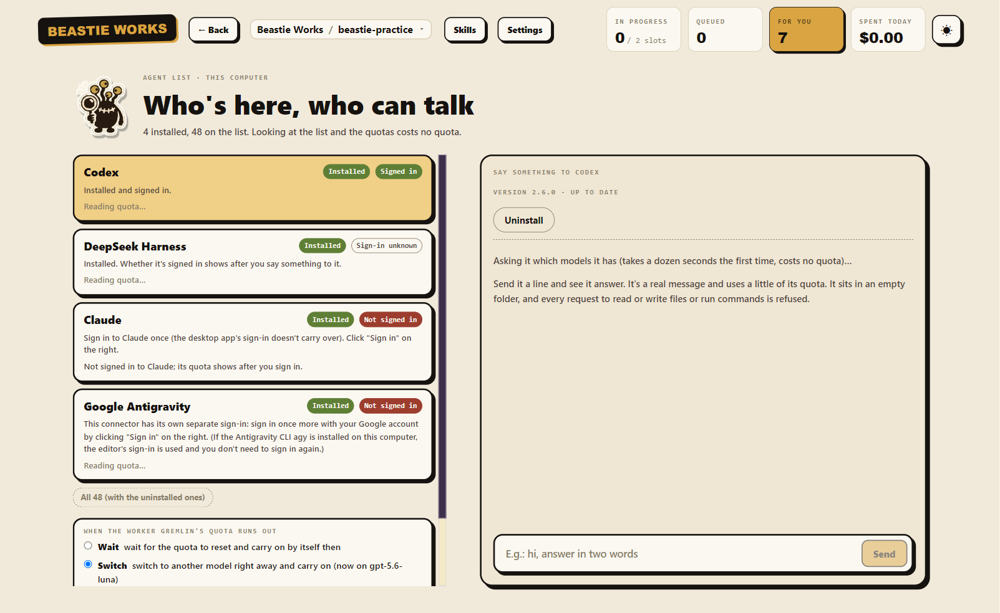

<p align="center">
  
</p>

<h1 align="center">Beastie Works</h1>

<p align="center">Put the AI agents already on your computer to work together.</p>

<p align="center">
  <a href="https://github.com/Yun-BaiBai/BeastieWorks/releases/latest"><strong>Download</strong></a> ·
  <a href="ROADMAP.md">Roadmap</a> ·
  <a href="CONTRIBUTING.md">Contributing</a> ·
  <a href="docs/benchmark.md">Benchmark</a> ·
  <a href="README.md">中文</a>
</p>

<p align="center">
  <a href="https://github.com/Yun-BaiBai/BeastieWorks/releases/latest"></a>
  
  <a href="LICENSE"></a>
</p>

<p align="center">
  
</p>

Beastie Works is a Windows desktop app. It brings no model of its own: it drives the agents already installed and signed in on your computer (Codex, Claude, Antigravity, DeepSeek and others) and has them share out the work you give.

You talk only to the **Lead Gremlin**. It turns what you say into tickets and hands each to a worker gremlin; when a job is done, an agent from another company reviews it against your own words; then you accept the result or send it back. Code, a novel, sorting video footage: any folder can be a project.

## Features

**Sharing out the work**
- **One ticket per job**: each ticket is done start to finish by one gremlin in its own working copy, so several can work at once without getting in each other's way.
- **Splitting large jobs**: a large job can first be split into independent pieces, which several gremlins do together once you agree. Small jobs are not split; one ticket is faster.
- **Work chains**: a large job in stages (say editing → voice-over → effects). When one stage is accepted you click "next stage"; the hand-over is the finished files and your own words.
- **Roundtable**: say "give me plans" and several agents each write one without seeing the others'. The Lead Gremlin sorts them into Plan A / Plan B, and the one you pick starts right away.

**Checks**
- **Review by another maker**: finished work is checked by another company's agent against your words, the changes and the verification. It can be sent back at most twice; after that, you decide.
- **Your files untouched until you accept**: changes reach the project only when you click Accept. If anything conflicts, nothing goes in, so your own edits are never overwritten.
- **Patrol**: work that runs too long, costs too much or may have drifted is flagged in the talk bar. Flagged only; you decide whether to stop it.

**Your own agents**
- **As they are**: each agent keeps its usual plugins, skills and sign-in. The list comes from the official public registry, 48 agents at present; missing ones install with one click, and npm and git ship with the app.
- **Sign in from the app**: Codex, Claude, Cursor, Kimi, Grok and Antigravity can be signed in from the agent list.
- **Quota you can see**: usage is read per agent. When it runs out you can wait for the reset or switch models (same maker, or another maker's through the bundled [Magpie](https://github.com/yetone/magpie)), set in advance and done automatically.

**More**
- **Project notes**: after each accepted job the Lead Gremlin notes your preferences and decisions, each backed by your own words. Notes can be read, edited, deleted or turned off.
- **Skill library**: ships with find-skills, agent-browser, agent-desktop and agent-reach, reads the skill folder your agents share, and imports from GitHub.
- **Voice input**: a mic button next to the text boxes uses Windows' own voice typing.
- **Chinese and English interface**, day and night themes.

<p align="center">
  
</p>

## Install

**Requirements**: Windows 10 or 11 (64-bit). At least one agent, which can also be installed from inside the app.

1. Download `Beastie-Works-x.y.z-win-x64-setup.exe` from [Releases](https://github.com/Yun-BaiBai/BeastieWorks/releases/latest).
2. Run it. The installer is not code-signed yet, so Windows may say "Windows protected your PC": choose "More info" → "Run anyway".
3. On first start, pick a project folder and an agent on this computer for each of the three roles: the Lead Gremlin, the worker gremlin, and review. Review works best with another company's agent.

Then tell the Lead Gremlin in the talk bar what you need.

## Supported agents

| Status | Agents |
|---|---|
| Have done real work | Codex, Claude, Antigravity, DeepSeek Harness |
| Install and report sign-in; no real work yet | Gemini, Copilot, Cursor, Kimi, Grok, OpenCode, Qwen and others, 48 on the list |

Only agents that can hold a conversation and work with the app are connected (those speaking the [Agent Client Protocol](https://agentclientprotocol.com)). Claude is not bundled; it installs from the official npm package on the agent list.

## Benchmark

The same three small jobs, done by one Codex used directly and by Beastie Works:

| | One Codex | Beastie Works |
|---|---|---|
| Total time | 268 s | 538 s (about 2×) |
| Total cost | $0.112 | about $0.15 (about 1.3×) |

On small jobs Beastie Works is slower and costs more. The extra buys a review by another maker and your files untouched until you accept; in one run the review caught a real mistake. Method and full numbers: [docs/benchmark.md](docs/benchmark.md).

## Known limitations

- Windows only, and only tested on Windows.
- The installer is not code-signed yet (we are preparing to apply for free signing for open-source projects).
- Most agents on the list have not yet been given real work one by one; signing in to Cursor, Kimi and Grok from the app has not been tried with real accounts.
- Quota: Claude and Codex are read directly, others through Magpie, and some cannot be read. For agents that don't report dollars, cost is estimated from official prices; subscribers are not actually charged that way.
- Switching to another maker's model through Magpie uses the subscription accounts signed in on your computer. Some services' terms may not allow this; judge for yourself and use only accounts in your own name.
- The instructions given to agents are written in Chinese; with the English interface, the gremlins talk to you in English.

## Privacy

Beastie Works collects and reports no usage data: no telemetry, no update checks. It goes online on its own only to read the official public agent registry and, with your own sign-in, your accounts' quota. The work you give the gremlins is sent by the agents you chose to their own makers. See [CODE_SIGNING.md](CODE_SIGNING.md).

## FAQ

**Will it change my project?**
Gremlins work in their own copies. Changes go into your project only when you click Accept, and the app never commits to git for you.

**Why does another maker review?**
A different company's model brings fresh eyes; a maker reviewing itself only rereads its own thinking.

**Does it cost anything?**
Beastie Works itself is free. The work runs on your own agents and accounts, billed the way each maker bills.

## Taking part

- Roadmap: [ROADMAP.md](ROADMAP.md)
- Contributing, local development, pull requests: [CONTRIBUTING.md](CONTRIBUTING.md)
- Security problems: [SECURITY.md](SECURITY.md)
- Code signing policy: [CODE_SIGNING.md](CODE_SIGNING.md)

## Development

Node.js 20 or newer.

```
npm install
npm run dev
```

Tests run under the app's own Electron and never call a model:

```
set ELECTRON_RUN_AS_NODE=1
node_modules\electron\dist\electron.exe --test test/native/v8-workbench.test.cjs
```

Installer: `npm run dist:win`. Set `BEASTIE_MAGPIE_EXE` (the Magpie v0.1.1336 program) and `BEASTIE_MINGIT_ZIP` (the MinGit 2.56.1 zip) first; both are checked against their fingerprints. The automated build on GitHub is in [.github/workflows/release.yml](.github/workflows/release.yml).

## License and credits

Released under the [MIT License](LICENSE).

Beastie Works started from the source code of [Munder Difflin](https://github.com/chaitanyagiri/munder-difflin) and has since been rewritten into a program of its own. It follows and adopts parts of the approach and code of [OpenMausBot](https://github.com/milind-soni/OpenMausBot), [Orca](https://github.com/stablyai/orca) and [T3 Code](https://github.com/pingdotgg/t3code), and ships with [Magpie](https://github.com/yetone/magpie), [Git for Windows](https://github.com/git-for-windows/git) and a few open-source skills. Their licenses and copyright notices are in [THIRD_PARTY_NOTICES.txt](THIRD_PARTY_NOTICES.txt).
