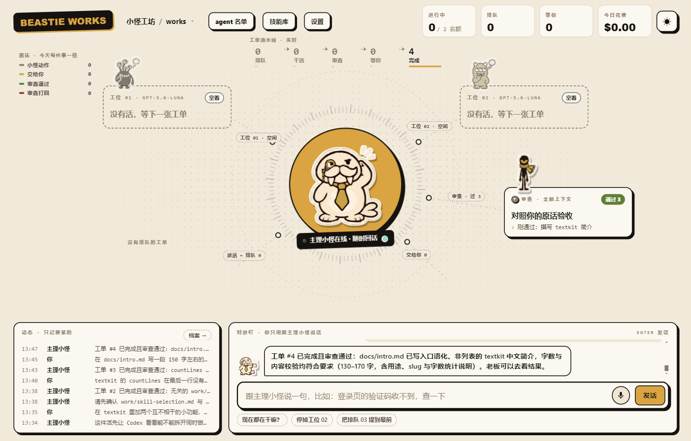
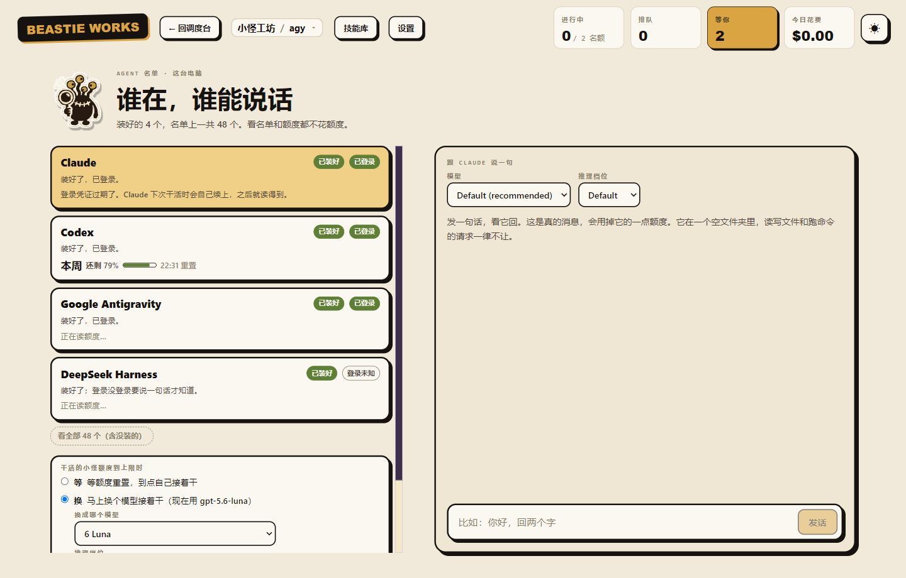

<p align="center">
  
</p>

<h1 align="center">小怪工坊 Beastie Works</h1>

<p align="center">把你电脑上已经装好的 AI agent 叫到一起，分工干活。</p>

<p align="center">
  <a href="https://github.com/Yun-BaiBai/BeastieWorks/releases/latest"><strong>下载</strong></a> ·
  <a href="ROADMAP.md">路线图</a> ·
  <a href="CONTRIBUTING.md">参与贡献</a> ·
  <a href="docs/benchmark.md">实测数字</a> ·
  <a href="README.en.md">English</a>
</p>

<p align="center">
  <a href="https://github.com/Yun-BaiBai/BeastieWorks/releases/latest"></a>
  
  <a href="LICENSE"></a>
</p>

<p align="center">
  
</p>

小怪工坊是一个 Windows 桌面程序。它不自带模型，而是调用你电脑上已经装好、登录好的 agent（Codex、Claude、Antigravity、DeepSeek 等），让它们分工完成你交代的事。

你只跟**主理小怪**说话。它把你的话变成工单，派给干活的小怪；活干完，由另一家公司的 agent 对照你的原话审查一次；最后由你决定收下还是打回。写程序、写小说、整理视频素材都可以，任何文件夹都能当作项目。

## 功能

**分工**
- **一件事一张工单**：每张工单由一只小怪从头做到尾，在自己的工作副本里干，几只同时干也互不干扰。
- **每个工位单独设置**：点开调度台上的工位，挑一只小怪、起个名字，配它用的 agent、模型、推理档位和能用的技能，最多 8 个工位。跟主理小怪说"让 2 号工位做""给小黑做"，活就只派给那个工位，它在忙就排队等它。
- **拆解工单**：大活可以先拆成几件各自独立的小活，你点头后几只小怪一起做；小活不拆，一张工单做完更快。
- **工序链**：一件大活分几道工序（比如剪辑 → 配音 → 特效），上一道收下后点"开下一道"，交接的是成品文件和你的原话。
- **圆桌会议**：说"出方案"，几家 agent 各自独立出方案，互相看不到；主理小怪整理成 Plan A / Plan B，你选了就开工。

**把关**
- **换一家审查**：做完的活由另一家公司的 agent 对照你的原话、改动和验证结果审一次，最多打回两次，之后交给你决定。
- **收下前原件不动**：改动只有在你点"收下"后才放进项目；有冲突时一个文件都不放，不会覆盖你自己改过的东西。
- **巡查**：干得太久、花得太多、可能跑偏的活，会在对讲栏提醒你。只提醒，停不停由你定。

**用你自己的 agent**
- **原样接入**：每个 agent 带着它平时的插件、技能和登录。名单从官方公开名单读取，目前 48 个；没装的点一下就装，程序自带 npm 和 git。
- **在程序里登录**：Codex、Claude、Cursor、Kimi、Grok、Antigravity 都能在名单页直接点"去登录"。
- **额度看得见**：读得到各家的用量。到上限时可以等它重置，也可以按备用清单换模型接着干（最多 5 个，同一家换，或经自带的 [Magpie](https://github.com/yetone/magpie) 换成别家）。每个工位、主理小怪、审查各设各的，事先设好就自动执行。
- **主理小怪和审查也能点开换**：点开它们的页面，直接换 agent、模型和档位。

**其他**
- **项目笔记**：每收下一件活，主理小怪记下你的偏好和定下的事，每条都附你的原话做依据；笔记能看、能改、能删、能关。
- **技能库**：自带 find-skills、agent-browser、agent-desktop、agent-reach，也读你电脑上共享的技能文件夹，能从 GitHub 导入。
- **语音输入**：输入框旁的麦克风按钮，用 Windows 自带的语音输入。
- **中文和英文界面**，白天和夜晚两种外观。

<p align="center">
  
</p>

## 安装

**系统要求**：Windows 10 或 11（64 位）。至少装一个 agent，也可以装好小怪工坊后在程序里一键装。

1. 到 [Releases](https://github.com/Yun-BaiBai/BeastieWorks/releases/latest) 下载 `Beastie-Works-x.y.z-win-x64-setup.exe`。
2. 双击安装。安装包暂时没有数字签名，Windows 提示"已保护你的电脑"时，点"更多信息" → "仍要运行"。
3. 第一次打开，选一个项目文件夹，再给三个角色各挑一个本机的 agent：主理小怪、干活的小怪、审查。审查最好选另一家公司的。

之后在对讲栏跟主理小怪说你要做什么就行。

## 支持的 agent

| 情况 | agent |
|---|---|
| 真派过活、跑通过 | Codex、Claude、Antigravity、DeepSeek Harness |
| 能装、能认出登录，还没真派过活 | Gemini、Copilot、Cursor、Kimi、Grok、OpenCode、Qwen 等，名单上共 48 个 |

只接能对话、能和程序配合的 agent（支持 [Agent Client Protocol](https://agentclientprotocol.com)）。Claude 不随程序预装，在名单页从官方 npm 包安装。

## 实测

用同样三件小活，比较直接用一个 Codex 和用小怪工坊：

| | 单个 Codex | 小怪工坊 |
|---|---|---|
| 合计时间 | 268 秒 | 538 秒（约 2 倍） |
| 合计花费 | $0.112 | 约 $0.15（约 1.3 倍） |

小活上小怪工坊更慢、更贵。多出来的部分换来的是另一家审查一次、收下前原件不动；其中一次审查拦下了一个真错。测法和完整数字见 [docs/benchmark.md](docs/benchmark.md)。

## 已知限制

- 只有 Windows 版，也只在 Windows 上测过。
- 安装包还没有数字签名（在准备申请开源项目的免费签名）。
- 名单上大多数 agent 还没逐家真派过活；Cursor、Kimi、Grok 的程序内登录还没用真账号试过。
- 额度：Claude、Codex 直接读取，其他经 Magpie 读取，有的读不到。不报美元的 agent，花费按官方价格估算，订阅用户实际不按这个扣钱。
- 经 Magpie 换别家模型，用的是你电脑上已登录的订阅账号，部分服务的条款可能不允许，请自行判断，只用自己名下的账号。
- 给 agent 的内部说明是中文写的；用英文界面时，小怪用英文跟你说话。
- **隔离不是绝对的**：小怪只能在自己的工作副本里改文件、跑测试，这靠两层：各家 agent 自带的沙盒（比如 Codex 只能写工作文件夹、不联网）和小怪工坊自己的审批规则。Windows 上没有系统级的隔离，小怪跑的项目脚本理论上能碰到别处；请只把你信得过的项目交给它们。
- **大文件（20 MB 以上）不复制**：为了省硬盘，视频、音频这类大文件是和项目共用同一个文件，工单没做完前设成只读；小怪要改它，会另存一个新文件交给你。工单开着时，你自己也没法直接改这个文件。

## 隐私

小怪工坊不收集、不上报任何使用数据，没有统计，也不检查更新。它自己联网只做两件事：读取 agent 官方公开名单，以及用你自己的登录读取你账号的额度。你交给小怪的活，由你选的 agent 发给它们各自的公司处理。详见 [CODE_SIGNING.md](CODE_SIGNING.md)。

## 常见问题

**会改动我的项目吗？**
小怪在自己的工作副本里干。只有你点"收下"，改动才会放进项目；程序不会替你提交 git。

**为什么审查要换一家？**
另一家公司的模型才有新的眼光；同一家审自己，等于把原来的思路重读一遍。

**要花钱吗？**
小怪工坊本身免费。干活用的是你自己的 agent 和账号，按各家自己的方式计费。

## 参与

- 路线图：[ROADMAP.md](ROADMAP.md)
- 参与贡献、本地开发、提 PR：[CONTRIBUTING.md](CONTRIBUTING.md)
- 安全问题：[SECURITY.md](SECURITY.md)
- 代码签名政策：[CODE_SIGNING.md](CODE_SIGNING.md)

## 开发

需要 Node.js 20 或更新。

```
npm install
npm run dev
```

测试用程序自带的 Electron 运行，不会调用任何模型：

```
set ELECTRON_RUN_AS_NODE=1
node_modules\electron\dist\electron.exe --test test/native/v8-workbench.test.cjs
```

打安装包：`npm run dist:win`。需要先设置 `BEASTIE_MAGPIE_EXE`（Magpie v0.1.1336 程序）和 `BEASTIE_MINGIT_ZIP`（MinGit 2.56.1 压缩包），两者都会核对文件指纹。GitHub 上的自动打包见 [.github/workflows/release.yml](.github/workflows/release.yml)。

## 许可与致谢

以 [MIT 许可](LICENSE) 发布。

小怪工坊最早从 [Munder Difflin](https://github.com/chaitanyagiri/munder-difflin) 的源代码起步，之后改写成了独立的程序；参考并采用了 [OpenMausBot](https://github.com/milind-soni/OpenMausBot)、[Orca](https://github.com/stablyai/orca)、[T3 Code](https://github.com/pingdotgg/t3code) 的部分做法和代码；随程序附带 [Magpie](https://github.com/yetone/magpie)、[Git for Windows](https://github.com/git-for-windows/git) 和几个开源技能。各自的许可和版权声明见 [THIRD_PARTY_NOTICES.txt](THIRD_PARTY_NOTICES.txt)。
