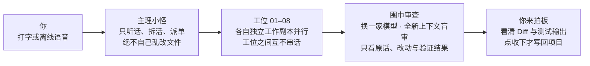
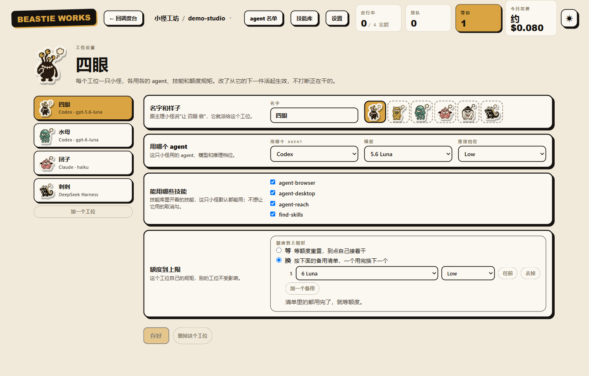
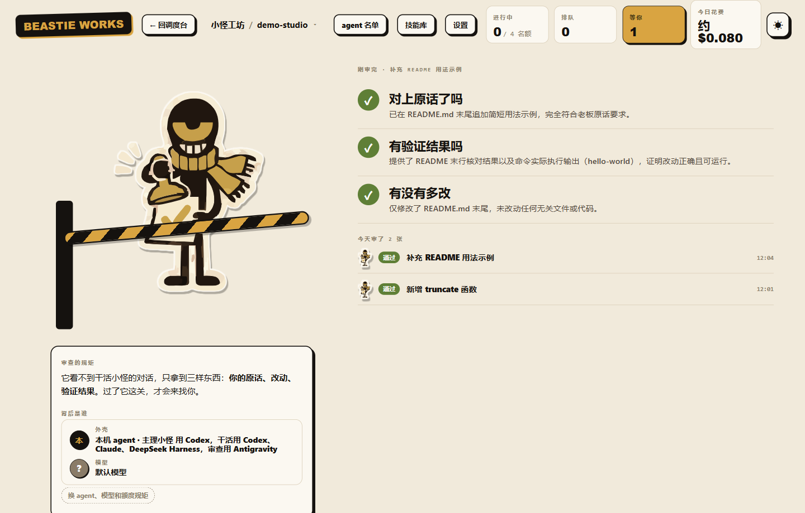
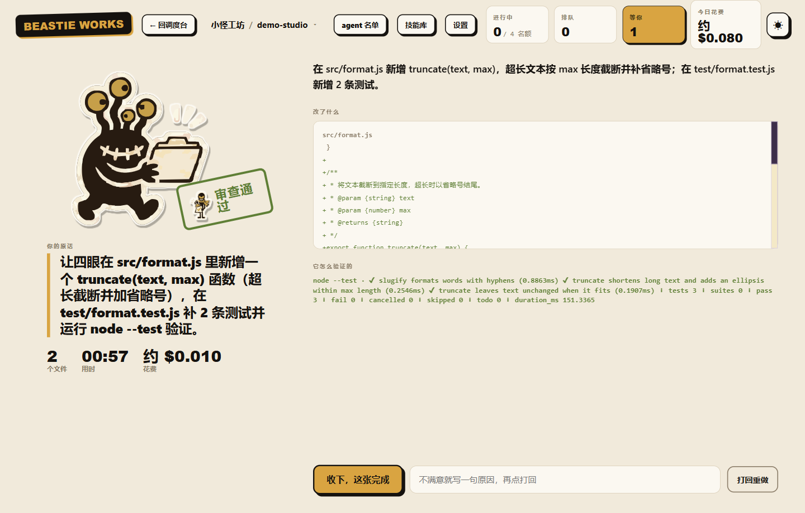
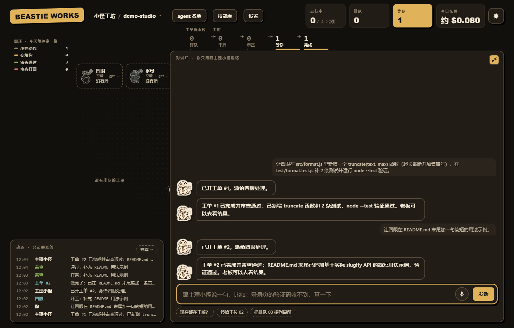
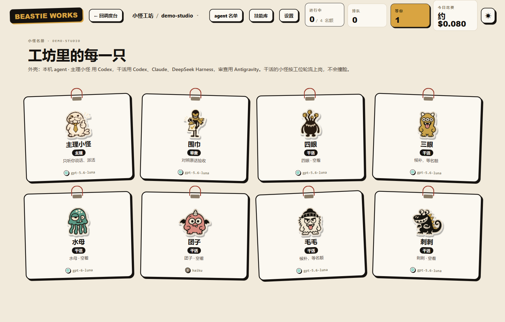

<p align="center">
  
</p>

<h1 align="center">小怪工坊 · Beastie Works</h1>

<p align="center">
  <strong>把你电脑上已经装好、登录好的 AI agent 叫到一起</strong><br />
  一个主理听你说话，最多八只小怪并行干活，换一家独立盲审，你点收下才落盘。
</p>

<p align="center">
  <a href="https://github.com/Yun-BaiBai/BeastieWorks/releases/latest"><strong>下载安装包</strong></a> ·
  <a href="#为什么做小怪工坊">为什么做它</a> ·
  <a href="#实机界面巡礼">界面巡礼</a> ·
  <a href="#3-分钟上手">3 分钟上手</a> ·
  <a href="docs/benchmark.md">实测数据</a> ·
  <a href="ROADMAP.md">路线图</a> ·
  <a href="README.en.md">English</a>
</p>

<p align="center">
  <a href="https://github.com/Yun-BaiBai/BeastieWorks/releases/latest"></a>
  
  
  
  <a href="LICENSE"></a>
</p>

<p align="center">
  <picture>
    <source media="(prefers-color-scheme: dark)" srcset="docs/screenshots/board-dark-zh.png" />
    <source media="(prefers-color-scheme: light)" srcset="docs/screenshots/board-zh.png" />
    
  </picture>
</p>
<p align="center">
  <sub>调度台实机截图（Windows 1.0.1 · 随 GitHub 主题自动切换白天 / 夜晚外观）</sub>
</p>

---

## 为什么做小怪工坊

用过不止一个 AI 编程 / 办公工具后，常见两类麻烦：

- **只用一个 agent**：开五六个窗口自己切 `git worktree`、人肉对 diff、查完一个再盯下一个；模型自我审查往往顺着同一套思路读过去，漏掉真问题。
- **搭一套多 agent“虚拟公司”**：强制拆成“产品经理 / 架构师 / 程序员 / 测试”来回开会扯皮，原本 1 分钟能干完的小活烧掉几倍时间和额度；而且还要丢掉你本机 agent 平时配好的订阅登录、插件、MCP 连接器和技能，重填一堆 API Key。

**小怪工坊走的是反过来的路子**：



| 你会直接感受到的变化 | 具体怎么做到 |
|---|---|
| **原样接管本机 Agent** | Codex、Claude、Google Antigravity、DeepSeek Harness 等直接沿用你电脑上现成的登录、插件、MCP 和技能，不重新造轮子 |
| **最多 8 个独立工位** | 每个工位单独选小怪、起名字、配 Agent / 模型 / 推理档位和技能开关，可直接点名“让四眼做” |
| **换一家全新上下文盲审** | 审查看不到干活小怪的对话过程，只拿**你的原话、改动 Diff、验证结果**，最多自动打回 2 次，之后交你拍板 |
| **收下前原件一动不动** | 每张工单都在独立工作副本里完成；你点“收下”前项目目录零改动，冲突时拦截并进 `.beastie-merge/`，程序也永不代提交 `git` |
| **额度看得见、撞限不断档** | 实时读取账号剩余额度（不花额度）；到上限可设“等重置”，或按最多 5 个备用模型自动接力（同厂或经内置 Magpie 跨厂） |
| **任何文件夹都能当项目** | 写代码自动跑测试，写文字逐条核对字数与要求，图片音视频查格式与截图；空文件夹也能直接开工 |

---

## 实机界面巡礼

> 以下全部为 **v1.0.1 实机运行真实小任务**（`Codex` 写代码 + `Google Antigravity` 跨厂审查）截取的 1440×920 画面。

### 1. 每个工位单独定制：混编多厂 Agent 梦之队

点开调度台上任意工位（最多 8 个），就能给它挑一只手绘小怪皮肤（共 6 种干活造型）、起一个好记的名字（如`四眼`、`水母`、`团子`、`刺刺`），独立设置它的 **Agent、模型、推理档位、可用技能**，以及**额度到上限后的应对规矩**。

- **点名派活**：跟主理小怪说“让四眼做”，活就只派给那个工位；它在忙就乖乖排队等它。
- **5 级备用接力**：工位撞到额度上限，可以选择等额度重置后自己续上，或者按提前排好的备用清单（最多 5 个，支持同厂降档或经内置 [Magpie](https://github.com/yetone/magpie) 换成别家模型）无缝接力。
- **主理与审查也能就地换源**：点开中间的主理小怪或右侧的审查卡片，随时更换它们背后的 Agent、模型和额度规矩，改完不打断正在干的活。

<p align="center">
  
</p>

### 2. 换一家盲审 + 交付台验收：先过安检，再落盘

干活小怪交活后，程序会把活交给**另一家公司**的模型把关（比如 Codex 干的活，交给 Google Antigravity 或 Claude 审），**不共享任何过程对话**，只对照三件事：**对上原话了吗 · 有验证结果吗 · 有没有多改**。

审查通过（或打回两次仍待定）后才会出现在交付台：看清高亮代码 Diff、真实命令验证输出、用时与花费，满意点**“收下，这张完成”**才会写入你的项目；收下过程即使遇到断电崩溃，下次打开也会凭交付日志放回原样。

<table>
  <tr>
    <td width="50%" align="center">
      <a href="docs/screenshots/review-zh.png"></a><br />
      <sub><strong>围巾审查门禁</strong>：全新上下文独立核对三要素与打回记录</sub>
    </td>
    <td width="50%" align="center">
      <a href="docs/screenshots/delivery-zh.png"></a><br />
      <sub><strong>交付台验收</strong>：绿章背书 + Diff 与测试输出核对后再放行落盘</sub>
    </td>
  </tr>
</table>

### 3. 48 款 Agent 一键装，免费查额度

基于开放的 [Agent Client Protocol (ACP)](https://agentclientprotocol.com) 官方公开名单，目前内置识别 **48 款 Agent**。程序随安装包自带 `npm` 与 `MinGit 2.56.1`——即使是一台刚装好系统、连 Node 和 Git 都没有的电脑，装上小怪工坊也能点一下安装缺失的 Agent。

- **程序内登录**：Codex、Claude、Cursor、Kimi、Grok、Google Antigravity 都能在名单页直接点“去登录”（若本机已装 Antigravity 命令行 `agy`，还会直接复用编辑器的登录，免去重复扫码）。
- **查看列表与额度不花任何额度**：左栏直接显示剩余百分比与重置时间，右侧可在空沙盒文件夹里发一句试聊（一切读写文件和跑命令请求一律拦截）。

<p align="center">
  
</p>

### 4. 更多顺手细节：离线语音、对讲栏拉高、圆桌与技能库

<table>
  <tr>
    <td width="50%" align="center">
      <a href="docs/screenshots/talk-dark-zh.png"></a><br />
      <sub><strong>夜晚模式 & 对讲栏拉高（1.0.1）</strong>：右上角一键拉高翻看完整对话，按 Esc 收回</sub>
    </td>
    <td width="50%" align="center">
      <a href="docs/screenshots/crew-zh.png"></a><br />
      <sub><strong>小怪名册</strong>：主理、围巾审查与 6 只干活小怪各司其职</sub>
    </td>
  </tr>
</table>

- **本机离线语音输入（1.0 新增）**：输入框旁的麦克风按钮内置 `transcribe-cpp` 引擎；首次点击会提示下载阿里巴巴 FunAudioLLM 开源的 **SenseVoice** 模型（约 253 MB），之后**完全离线识别，不联网、不花钱**。
- **圆桌会议**：对主理小怪说“出方案”，几家 Agent 互相看不见对方、各自独立盲写方案；主理汇总成 **Plan A / Plan B**，你点选后立刻开工，不搞无休止的互相辩论。
- **大活拆解 & 工序链**：小活不强拆，一张工单直接干完更快更省；大活可先拆成几件互不干扰的小活，经你点头后再多工位并行；长流程（如`剪辑 → 配音 → 特效`）走工序链，上一道收下后再把成品文件与原话交接给下一道。
- **主理重启接着聊 & 项目笔记**：关闭重开程序后主理小怪仍记得之前的对话；每收下一张工单，主理自动摘录你的偏好和踩过的坑（附原话出处），支持查看、编辑、删除或随时关闭。
- **通用技能库 & 定时巡查**：随程序自带 `find-skills`、`agent-browser`、`agent-desktop`、`agent-reach`（配套工具可一键安装），并自动读取本机 `~/.agents/skills`、`~/.claude/skills` 等共享技能目录，支持贴 GitHub / `skills.sh` 链接导入；干得太久、花超预算或可能跑偏时，巡查会在对讲栏出声提醒（只提醒，停不停永远由你定）。

---

## 3 分钟上手

**系统要求**：Windows 10 或 Windows 11（64 位）。电脑上至少有一个已登录的 agent（也可以装好小怪工坊后再在“agent 名单”里一键安装并登录）。

1. 前往 [GitHub Releases](https://github.com/Yun-BaiBai/BeastieWorks/releases/latest) 下载最新的 `Beastie-Works-x.y.z-win-x64-setup.exe`。
2. 双击安装。安装包目前还没有商业数字签名，Windows 弹出“已保护你的电脑”时，点击 **“更多信息” → “仍要运行”**。
3. 首次打开后，选择任意一个项目文件夹，分别为**主理小怪**、**干活的小怪**、**审查**挑好本机 Agent（建议审查选另一家公司的）。

之后你只需要在对讲栏里像平时聊天一样交代事情：

```text
· 直接派活：在 src/format.js 里加一个 truncate 函数并补 2 条测试，跑 node --test 验证
· 点名工位：让四眼修一下登录页的表单校验报错
· 圆桌出方案：给这个项目加暗色主题切页方案，先开圆桌出方案给我选
· 分阶段接力：做一段 30 秒产品演示视频，分三道工序：先出脚本，再配音，最后合成字幕
· 现场调度：现在都在干嘛？ / 停掉工位 02 / 把排队 03 提到最前
```

---

## 支持的 Agent

小怪工坊只接入支持对话并能按工具边界配合的 [Agent Client Protocol (ACP)](https://agentclientprotocol.com) agent：

| 状态 | Agent |
|---|---|
| **已真派活跑通全流程** | **Codex**、**Claude**、**Google Antigravity**、**DeepSeek Harness** |
| **可安装并识别状态（待逐家真派活实测）** | **Gemini**、**GitHub Copilot**、**Cursor**、**Kimi**、**Grok**、**OpenCode**、**Qwen**、**Kiro**、**Cline**、**Droid**、**Devin** 等官方名单共 **48 个** |

> 说明：因授权协议限制，**Claude** 不随安装包预装，可在程序内的“agent 名单”页从官方 npm 包一键安装并登录。

---

## 坦诚的实测对比

在同样一台 Windows 电脑上，用同一份 3 个文件的 Node.js 文本工具项目、一字不差的三条指令（`T1 两个独立功能`、`T2 修 bug`、`T3 写 150 字中文简介`），对比**直接用单个 Codex** 与 **小怪工坊（Codex 干活 + Claude Haiku 独立审查）**（完整方法与日志见 [docs/benchmark.md](docs/benchmark.md)）：

| 对比项 | 直接用单个 Codex | 小怪工坊（初测） | 小怪工坊（收紧小活拆解后） |
|---|---|---|---|
| **三件活合计用时** | 268 秒 | 586 秒（约 2.2 倍） | **538 秒（约 2.0 倍）** |
| **三件活合计估算花费** | $0.112 | $0.245（约 2.2 倍） | **约 $0.15（约 1.3 倍）** |

**直白说结论**：在小活上，小怪工坊**不会比单开一个 agent 更快、更省钱**。多出来的那部分时间和约 30% 花费，买的是：**先判断值不值得拆、由另一家公司模型独立把一次关、以及你点头收下前项目原件纹丝不动**——就在 `T1` 重测那轮，Claude 审查实打实拦下了 `wordCount` 把中文标点误算成单词的 bug，打回让 Codex 修好并补测试后才放行。

---

## 已知限制与隐私承诺

我们不遮掩当前版本的边界：

- **系统与签名**：目前仅提供并测试过 **Windows 10/11 (x64)** 版；安装包暂未加数字签名（正在向 [SignPath Foundation](https://signpath.org/) 申请开源免费签名，进度见 [CODE_SIGNING.md](CODE_SIGNING.md)）。
- **部分 Agent 实测覆盖**：官方名单上共有 48 个 agent，目前除 Codex、Claude、Google Antigravity、DeepSeek Harness 外，其余多数尚未逐家真派活跑满全流程；Cursor、Kimi、Grok 的程序内登录也尚待真实账号逐一实测。
- **额度与计费口径**：Claude、Codex 额度直接读取，其余经内置 Magpie 读取（少数厂商读不到）；不直接上报美元金额的 agent，界面花费按内置官方单价表（LiteLLM 价格）估算，包月/订阅用户实际并不按此扣费。
- **跨厂换源条款提醒**：经自带的 Magpie 使用本机已登录订阅账号切换到别家模型时，部分服务商的用户条款可能不允许此类转发调用；请自行评估风险，且务必只使用自己名下的账号。
- **内部指令语言**：调度与审查的内部系统提示词以中文编写；在英文界面下，小怪会用英文与你对话，但审查页的部分检查项标题可能仍以中文显示。
- **沙盒隔离不是绝对的**：小怪工坊依赖两层防线把工作小怪关在副本文件夹里——各家 agent 自带沙盒（例如工作中的 Codex 开启 `workspace-write`，禁止写副本外目录且断网）以及程序的工具审批规则。但 Windows 上没有内核级容器隔离，项目自身的构建/测试脚本理论上仍可能访问外部路径，**请只把信得过的项目文件夹交给小怪**。
- **≥ 20 MB 大文件不复制**：为避免视频、音频、大型素材塞满硬盘，20 MB 以上大文件与原项目共享同一份文件（硬链接），相关工单未结束前保持只读锁定（最后一张共用工单结束才解锁）；小怪需要修改时会另存新文件交给你。

### 隐私声明

**小怪工坊不收集、不上报任何使用数据**——没有埋点统计，也没有静默自动更新检查。程序主动发起的网络请求只有两件事：拉取 [ACP 官方公开名单](https://cdn.agentclientprotocol.com/registry/v1/latest/registry.json)，以及凭你自己的登录态读取你的账号剩余额度。其余联网行为（安装 agent 或技能工具、从 GitHub 导入技能、打开官方登录页、首次点击语音时下载 SenseVoice 模型）全部在你明确点击后才会发生。你交代给小怪的工作内容，由你选定的 agent 直接发往其对应厂商处理。详见 [CODE_SIGNING.md](CODE_SIGNING.md)。

---

## 常见问题

<details>
<summary><strong>Q：小怪在里面一顿操作，会直接把我的项目改乱吗？</strong></summary>

不会。每张工单都在独立的 git 工作副本里执行（非 git 文件夹也会先建本地快照）。只有审查通过后、你在交付台亲手点下 **“收下，这张完成”**，改动才会合回你的项目目录；而且遇到文件冲突时一个文件都不会覆盖，程序也绝不会替你执行 `git commit` 或 `git push`。
</details>

<details>
<summary><strong>Q：为什么坚持让“另一家公司”的模型来做审查？</strong></summary>

同一家模型往往带着相似的训练偏好和盲区，自己审自己很容易顺着原思路“一眼通过”。换一家不同公司、且**完全看不到干活过程对话**的模型，只拿你的原话、Diff 和验证输出来盲审，才真正构成一次独立把关。
</details>

<details>
<summary><strong>Q：小怪工坊收费吗？里面调用的模型怎么算钱？</strong></summary>

小怪工坊本身完全免费且 MIT 开源。它不提供、不转售任何模型算力，跑起来的都是你本机已经装好并登录的 agent 与订阅/API 账号，按各家原平台规则计费；语音输入在下载完约 253 MB 的本地 SenseVoice 模型后也完全免费离线运行。
</details>

<details>
<summary><strong>Q：电脑上连 Node.js 和 Git 都没装，朋友拿到安装包能直接用吗？</strong></summary>

可以。安装包里已经随程序内置了 `npm`（通过自带 Electron 运行）和精简版 `MinGit 2.56.1`，装好打开就能在“agent 名单”里一键下载并登录所需 agent。
</details>

---

## 参与贡献与本地开发

- **路线图**：[ROADMAP.md](ROADMAP.md)
- **贡献指南与 PR 规范**：[CONTRIBUTING.md](CONTRIBUTING.md)
- **安全漏洞披露**：[SECURITY.md](SECURITY.md)
- **代码签名与隐私政策**：[CODE_SIGNING.md](CODE_SIGNING.md)

### 本地运行与测试（需要 Node.js 20+）

```powershell
npm install
npm run dev
```

使用程序自带的 Electron 跑本地测试（全部使用 `test/fixtures` 替身，不调用真实模型、不花额度）：

```powershell
set ELECTRON_RUN_AS_NODE=1
node_modules\electron\dist\electron.exe --test test/native/v8-workbench.test.cjs
```

构建 Windows 安装包（需先设置 `BEASTIE_MAGPIE_EXE` 为 Magpie v0.1.1336 路径、`BEASTIE_MINGIT_ZIP` 为 MinGit 2.56.1 压缩包路径，两者都会校验文件指纹；GitHub Actions 自动构建见 [.github/workflows/release.yml](.github/workflows/release.yml)）：

```powershell
npm run dist:win
```

---

## 许可与致谢

本项目以 [MIT License](LICENSE) 开源发布。

小怪工坊最早从 [Munder Difflin](https://github.com/chaitanyagiri/munder-difflin) 的源代码起步，之后改写为独立的桌面工作台程序；在能力设计与实现上参考或采用了 [OpenMausBot](https://github.com/milind-soni/OpenMausBot)、[Orca](https://github.com/stablyai/orca)、[T3 Code](https://github.com/pingdotgg/t3code) 等项目的做法；安装包随附 [Magpie](https://github.com/yetone/magpie)、[Git for Windows (MinGit)](https://github.com/git-for-windows/git)、`transcribe-cpp`（配合阿里巴巴 FunAudioLLM SenseVoice 模型）以及四个内置开源技能。完整版权与第三方许可声明见 [THIRD_PARTY_NOTICES.txt](THIRD_PARTY_NOTICES.txt)。
